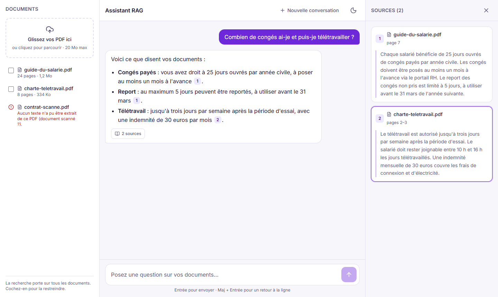
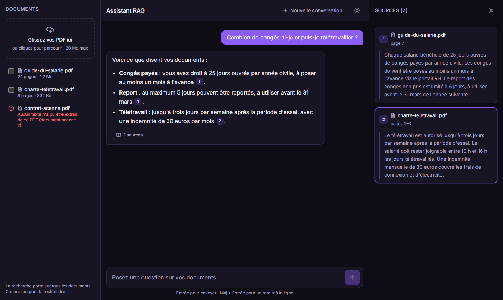
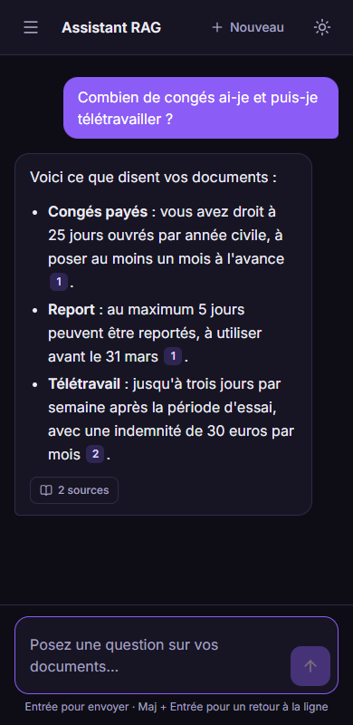
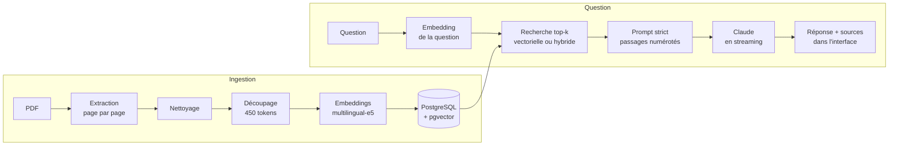

# Assistant IA sur documents PDF (RAG)

[](https://github.com/BoubacarThiam/rag-assistant/actions/workflows/ci.yml)

**Démo : https://boubacarthiam.github.io/rag-assistant/** (protégée par mot de passe, sur demande ;
en ligne quand l'ordinateur qui l'héberge est allumé).

Une application de chat qui répond aux questions **uniquement à partir des PDF que vous importez**,
et qui **cite ses sources** : chaque affirmation renvoie à un document, une page et un extrait.
Si l'information n'est pas dans les documents, l'assistant le dit au lieu d'inventer.

L'objectif du projet n'est pas d'appeler une API, mais de construire un pipeline RAG complet
(*Retrieval-Augmented Generation*), **mesuré** par une suite d'évaluation et **testé**.



<details>
<summary>Thème sombre et version mobile</summary>




</details>

## Fonctionnalités

- Import de PDF par glisser-déposer, traitement en tâche de fond avec statut (`processing` → `ready`).
- Réponses en streaming (Server-Sent Events), citations `[1]`, `[2]` cliquables qui ouvrent l'extrait.
- Deux modes au choix dans l'interface :
  - **Mes documents** (par défaut) : réponses uniquement à partir des PDF, avec sources, et refus
    explicite quand la réponse n'y est pas ;
  - **Connaissances générales** : les PDF d'abord (cités) quand ils répondent, sinon les
    connaissances du modèle. Une réponse sans source est signalée « hors de vos documents ».
- Historique des conversations dans la barre latérale : rouvrir une conversation pour la
  poursuivre, ou la supprimer.
- Autour des messages : copier une réponse ou un bloc de code, « Réessayer » une réponse en
  échec, « Modifier » une question (renvoyée dans la zone de saisie), export de la conversation
  en Markdown avec ses sources, bouton pour revenir au dernier message.
- Recherche vectorielle, plein texte ou hybride ; reranking optionnel.
- Thème clair/sombre, interface utilisable sur mobile.

## Comment ça marche



1. **Ingestion.** Le texte est extrait page par page (PyMuPDF), nettoyé (en-têtes répétés, césures),
   puis découpé en passages de 450 tokens avec un chevauchement de 75. Chaque passage garde sa page
   d'origine pour pouvoir être cité.
2. **Embeddings.** Chaque passage est transformé en vecteur de 768 nombres par
   `intfloat/multilingual-e5-base`, qui fonctionne en français. Le titre du document est ajouté au
   passage avant ce calcul (voir [Résultats](#résultats)).
3. **Recherche.** La question est transformée en vecteur ; PostgreSQL retrouve les 5 passages les
   plus proches (distance cosinus, index HNSW). En mode hybride, une recherche plein texte
   (`french`) est fusionnée avec la recherche vectorielle par *Reciprocal Rank Fusion*.
4. **Génération.** Claude reçoit les passages numérotés et une consigne stricte : n'utiliser que
   ces passages, citer `[n]` après chaque affirmation, sinon répondre
   « Je ne trouve pas cette information dans tes documents. ».

## Résultats

Chaque amélioration a été mesurée avant d'être adoptée, avec la suite d'évaluation
([`eval/`](eval/README.md)) : 28 questions sur 6 documents fictifs, dont 5 sans réponse.

| Recherche (23 questions avec réponse, k = 5) | Avant | Après |
|---|---|---|
| Configuration | passages de 450 tokens | + titre du document |
| Hit rate@1 (bon passage en 1re position) | 73,9 % | **82,6 %** |
| Hit rate@5 (bon passage dans les 5 premiers) | 95,7 % | **100 %** |
| MRR | 0,848 | **0,906** |

Ce que les expériences ont appris (détails dans [`docs/EXPERIMENTS.md`](docs/EXPERIMENTS.md)) :

- **Des passages plus petits dégradaient la recherche** (MRR 0,85 → 0,52 à 200 tokens) : sorti de
  son document, un petit passage ne dit plus de quelle entreprise il parle.
- **Ajouter le titre du document** au passage avant l'embedding corrige ce problème, sans coût à
  la recherche. Activé par défaut.
- **Le reranking par cross-encoder** gagne une à deux questions, mais fait passer la recherche de
  0,25 s à plus de 10 s sur CPU. Désactivé par défaut.

> Avec 23 questions, une question pèse 4,3 points : ces chiffres montrent des tendances, pas des
> écarts fins. Non encore mesurés : la recherche hybride sur PostgreSQL et la qualité des réponses
> générées (LLM juge), qui demande une clé API.

## Installation

Prérequis : Docker et une clé API, Anthropic (Claude) ou d'un fournisseur gratuit (voir plus bas).

```bash
git clone https://github.com/BoubacarThiam/rag-assistant.git
cd rag-assistant
cp .env.example .env          # puis renseigner ANTHROPIC_API_KEY
docker compose up --build
```

**Avec un modèle gratuit.** Toute API au format OpenAI fonctionne (Groq, Gemini, Ollama en
local…). Exemple avec l'offre gratuite de Groq, dans `.env` :

```
LLM_PROVIDER=openai_compatible
LLM_BASE_URL=https://api.groq.com/openai/v1
LLM_API_KEY=gsk_...
LLM_MODEL=openai/gpt-oss-120b
LLM_MAX_TOKENS=4096
```

- Interface : http://localhost:5173
- API et documentation interactive : http://localhost:8000/docs

Au premier import, le modèle d'embedding (~1 Go) est téléchargé une fois, puis gardé en cache.

**Sans clé API ni backend**, pour voir l'interface avec des données d'exemple :

```bash
cd frontend && npm install
npm run mock   # terminal 1 : fausse API sur :8000
npm run dev    # terminal 2 : http://localhost:5173
```

### Production

```bash
cp .env.example .env   # changer POSTGRES_PASSWORD, renseigner ANTHROPIC_API_KEY
docker compose -f docker-compose.prod.yml up -d --build
```

Différences avec le mode développement : le frontend est un build statique servi par nginx
(port 80, qui relaie `/api` vers le backend sans mise en tampon pour le streaming), pas de code
monté ni de rechargement automatique, base non exposée hors de Docker, redémarrage automatique.

### Démo publique depuis son ordinateur

Une image unique (API + interface, [`deploy/Dockerfile`](deploy/Dockerfile)) utilise une base
PostgreSQL hébergée (par exemple Neon, gratuite) et un tunnel Cloudflare qui donne une adresse
publique en HTTPS, sans ouvrir de port. Les visiteurs doivent saisir un mot de passe.

```bash
# dans .env : DEPLOY_DATABASE_URL=postgresql://... et DEMO_PASSWORD=...
docker compose -f docker-compose.demo.yml up -d --build
docker compose -f docker-compose.demo.yml logs tunnel | grep trycloudflare   # adresse publique
docker compose -f docker-compose.demo.yml down                              # arrêter
```

L'adresse du tunnel change à chaque démarrage. Une page de redirection publiée avec GitHub Pages
(branche `gh-pages`) donne une adresse fixe, **https://boubacarthiam.github.io/rag-assistant/** ;
après chaque démarrage, `python deploy/demo_link.py` la fait pointer vers le nouveau tunnel.
La démo n'est en ligne que quand l'ordinateur est allumé.

**Surveillance automatique** ([`deploy/watchdog.py`](deploy/watchdog.py)) : toutes les minutes,
elle relance Docker et les conteneurs s'ils sont arrêtés, teste l'adresse publique comme un
visiteur, recrée le tunnel après trois échecs et met le lien court à jour. Installée comme tâche
Windows lancée à l'ouverture de session (journal : `demo-watchdog.log`) :

```powershell
powershell -ExecutionPolicy Bypass -File deploy/install-watchdog.ps1              # installer
powershell -ExecutionPolicy Bypass -File deploy/install-watchdog.ps1 -Uninstall   # retirer
```
La même image se déploie sur Google Cloud Run ou Hugging Face Spaces
([`deploy/cloudrun`](deploy/cloudrun/deploy.py), [`deploy/huggingface`](deploy/huggingface/deploy.py)).

## Tests et qualité

```bash
docker compose exec api pytest          # backend : unitaires + intégration (PostgreSQL de test)
cd frontend && npm test                 # frontend : Vitest + Testing Library
```

- Aucun test ne télécharge le modèle d'embedding ni n'appelle Claude : des faux fournisseurs
  déterministes (`FakeEmbeddingProvider`, `FakeLLMProvider`) les remplacent.
- Les tests d'intégration tournent sur une vraie base PostgreSQL + pgvector.
- `ruff`, `mypy --strict` et TypeScript `strict` sont appliqués.
- La [CI GitHub Actions](.github/workflows/ci.yml) vérifie tout cela à chaque push, puis démarre
  les deux configurations Docker Compose et contrôle qu'elles répondent.

## Choix techniques

| Choix | Pourquoi |
|---|---|
| **PostgreSQL + pgvector** plutôt qu'une base vectorielle dédiée | Une seule base pour les documents, les conversations, les vecteurs et la recherche plein texte ; transactions et suppressions en cascade gratuites. |
| **multilingual-e5-base** en local | Bon en français, gratuit, sans envoyer les documents à un tiers pour l'indexation. Préfixes `query:` / `passage:` obligatoires pour ce modèle. |
| **Taille mesurée en tokens** du modèle d'embedding | Le modèle tronque au-delà de 512 tokens : compter en caractères laisserait passer des passages coupés sans le savoir. |
| **Interfaces `EmbeddingProvider` / `LLMProvider`** | Les services ne dépendent pas d'un fournisseur ; les tests utilisent des versions factices. Ajouter un second fournisseur (API au format OpenAI : Groq, Gemini, Ollama) n'a demandé qu'un fichier, sans toucher au reste. |
| **SSE** plutôt que WebSocket | Le flux ne va que du serveur au client ; SSE passe par HTTP standard et se relaie facilement par nginx. |
| **Évaluation avant optimisation** | Sans mesure, l'intuition « des passages plus petits seront plus précis » aurait été adoptée — elle était fausse. |

## Stack

**Backend** : Python 3.12, FastAPI, SQLAlchemy 2 (async), Alembic, Pydantic v2, PyMuPDF,
sentence-transformers, SDK `anthropic`, `uv`.
**Base** : PostgreSQL 16 + pgvector (HNSW, cosinus) et recherche plein texte `french`.
**Frontend** : React, Vite, TypeScript, Tailwind CSS v4.
**Tests** : pytest, pytest-asyncio, httpx, Vitest, Testing Library.

## API

| Méthode | Route | Rôle |
|---|---|---|
| `POST` | `/documents` | Importer un ou plusieurs PDF (traitement en arrière-plan) |
| `GET` | `/documents`, `/documents/{id}` | Lister les documents et leur statut |
| `DELETE` | `/documents/{id}` | Supprimer un document et ses passages |
| `POST` | `/search` | Recherche seule (sans génération) |
| `POST` | `/chat` | Question → réponse en streaming SSE (`meta`, `sources`, `token`, `done`, `error`) |
| `GET` | `/conversations` | Conversations récentes (titre = première question), la plus active d'abord |
| `DELETE` | `/conversations/{id}` | Supprimer une conversation et ses messages |
| `GET` | `/conversations/{id}/messages` | Historique d'une conversation |
| `GET` | `/health` | État de l'API et de la base |

## Organisation du dépôt

```
backend/app/
  api/          routes HTTP (fines)
  services/     ingestion, embeddings, retrieval, llm, orchestration du chat
  models/ schemas/ core/   SQLAlchemy, Pydantic, config, erreurs, logs
backend/tests/  unit/ et integration/
frontend/src/   composants React, hooks, client API et parseur SSE
eval/           jeu de questions, métriques, LLM juge, rapports
docs/           PLAN.md (phases), EXPERIMENTS.md (mesures), captures
```

## Limites

- Les PDF scannés (images sans texte) ne sont pas lus : il n'y a pas d'OCR.
- Les tableaux et mises en page en colonnes sont extraits comme du texte brut.
- Le titre utilisé comme contexte vient du nom du fichier : `scan_0042.pdf` n'apporte rien.
- Pas d'authentification : l'application est prévue pour un usage local ou derrière un accès protégé.
